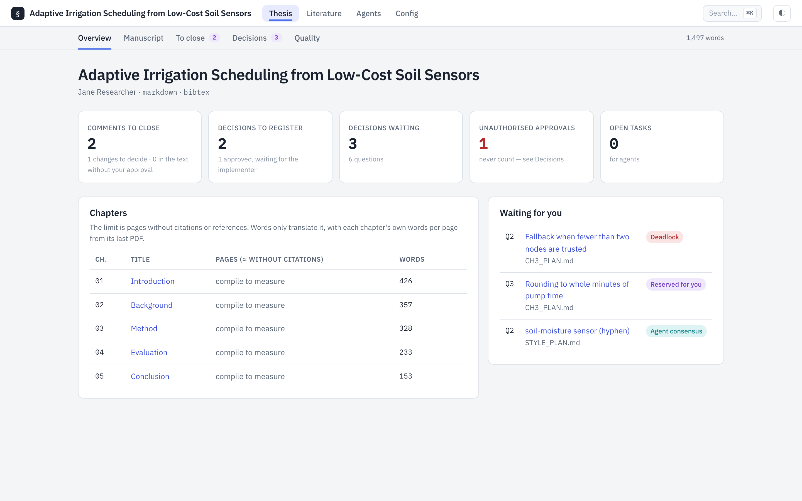
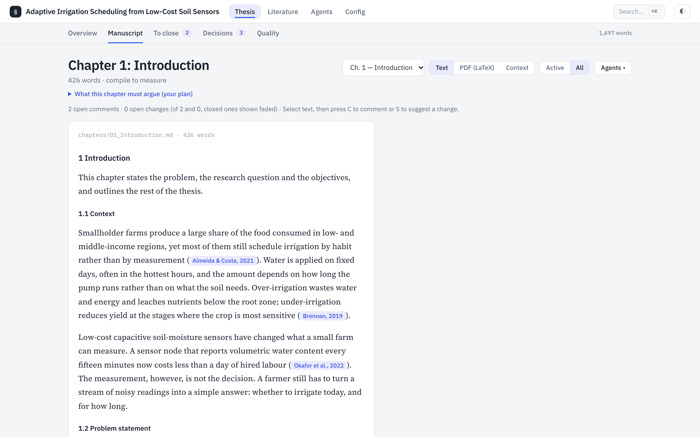
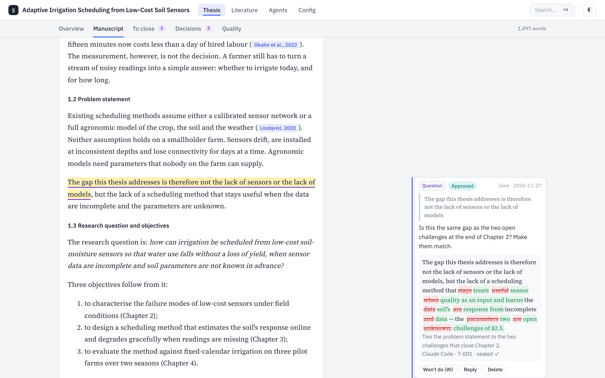
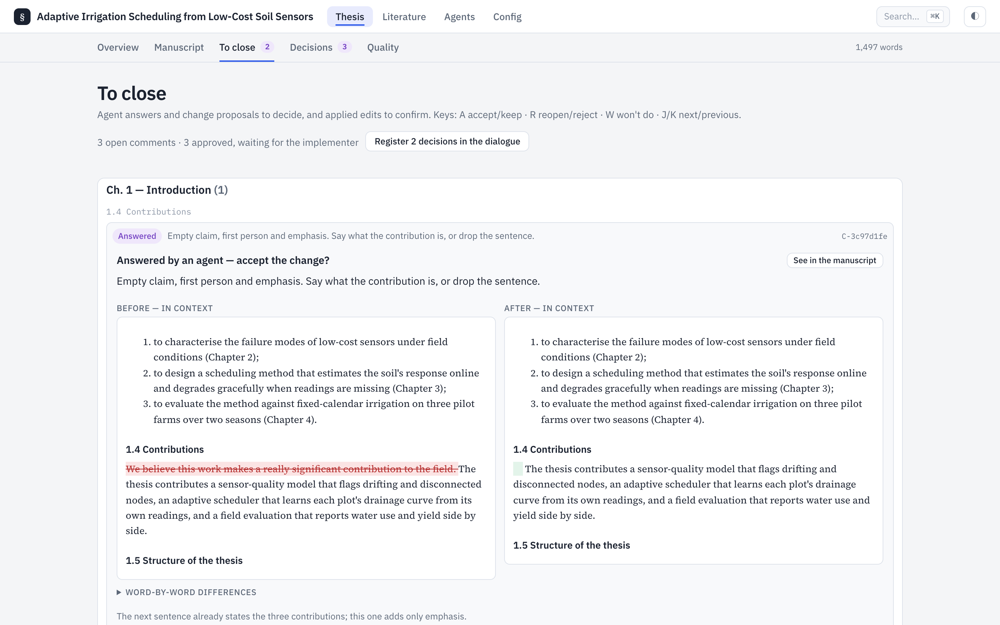
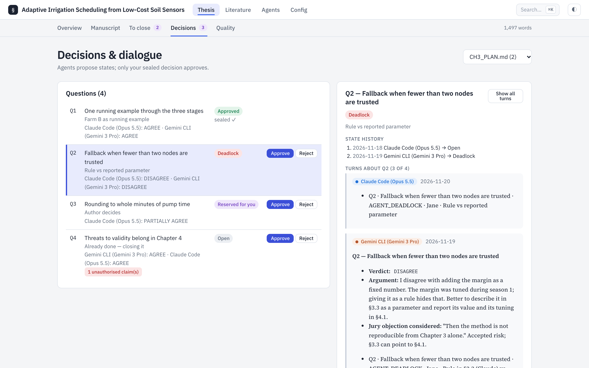
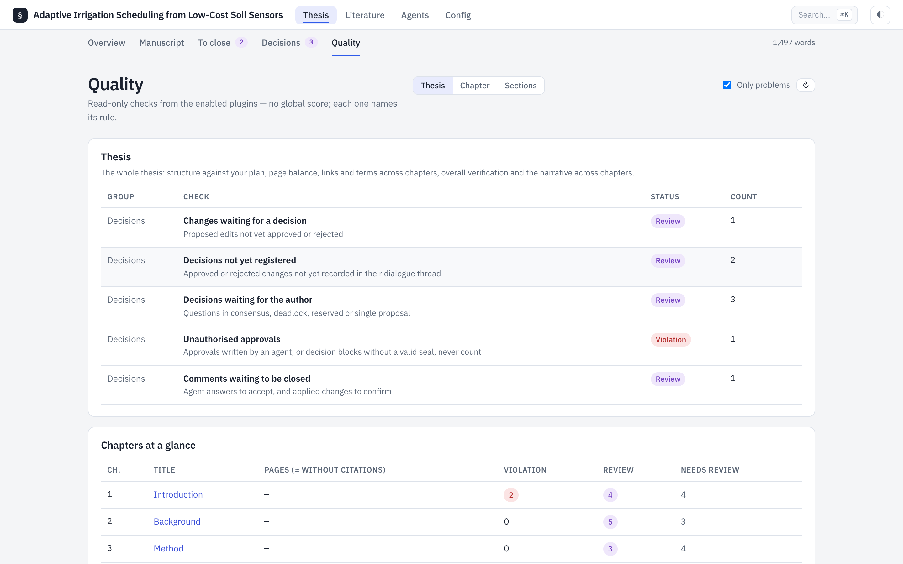
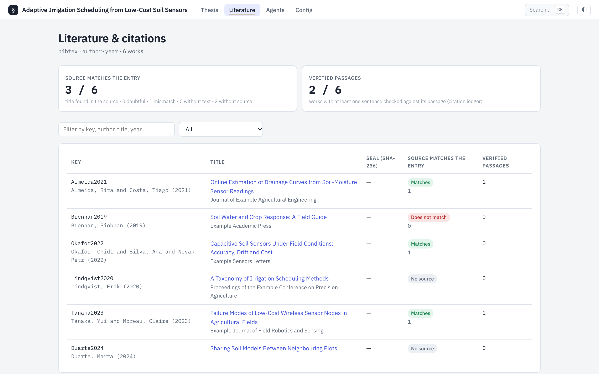
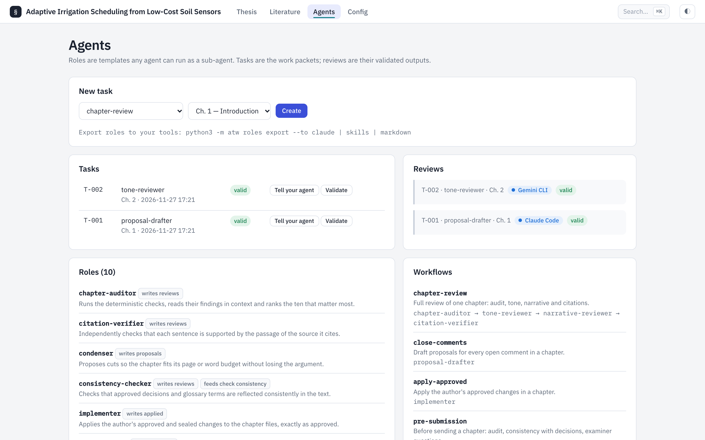

# Agentic Thesis Workbench

A local, model-agnostic web workbench for writing a thesis with several AI agents under the author's control.

- **Zero dependencies:** Python 3.11+ standard library and vanilla HTML/CSS/JS. No build step; the test suite runs in seconds.
- **Bring your own format, citations and agents:** `thesis.toml` says where things are; your own plan
  (`.thesis/plan.toml`: chapters, pages, words, sections, what each chapter must argue, writing rules) is kept
  apart. The engine ships with **no limits of its own** — an unset rule reports "not configured".
- **Comments that are easy to make and easy to close:** select text, press `C` (comment) or `S` (suggest a change);
  agents answer with before/after proposals; you accept, an implementer applies, you confirm — all in a *To close* queue.
- **Roles as templates for sub-agents:** reviewers (tone, narrative, consistency, citations, examiner), drafters and an
  implementer, exportable to Claude Code sub-agents, Agent Skills (`SKILL.md`) or plain prompts.
- **Pages, not words:** the page budget comes from the last LaTeX/PDF build (references and in-text citations
  left out); words only translate it with each chapter's own words per page. Compile from the Manuscript and
  read the PDF next to your comments — comments always stay on the text.
- **Change proposals** decided item by item, sealed, registered in the dialogue and applied by an implementer.
- **Quality checks as plugins:** structure, formatting, citations, style, page budget, governance and agent reviews —
  no global score, every check names its rule. Add your own rules in `.thesis/plugins/`.
- **Human-in-the-loop by construction:** agents only propose; approvals are HMAC-sealed by the author's key, so an
  agent cannot approve a decision or a text change by editing a file.
- **LaTeX or Word base, on a thesis template:** pick `[output] base = "latex" | "word"` and a template. Ships the
  University of Minho doctoral template (Despacho RT-80/2026) for LaTeX, with a slot for the official Word model.
- **Zotero and Mendeley:** sync your library (Zotero 7 on this computer or the web API; Mendeley API or a BibTeX/RIS
  export) into the bibliography the workbench checks, and into a `.bib` for LaTeX.
- **Interface in English or Portuguese** (`[ui] locale`); data, files and code stay in English.
- **Standalone or embedded** behind a host portal (`--host-shell second-brain`).

## Feature tour

The screenshots below come from [`examples/demo-thesis`](examples/demo-thesis), a small fictional thesis
(*Adaptive Irrigation Scheduling from Low-Cost Soil Sensors*) whose comments, agent tasks and sealed approvals were
produced through the workbench itself. Run it yourself:

```bash
ATW_SIGNING_KEY=examples/demo-thesis/.thesis/demo-signing.key python3 -m atw serve --workspace examples/demo-thesis
```

### Overview: what is waiting for you

Comments to close, decisions to register, questions waiting for the author and approvals an agent tried to write
itself, next to every chapter's size and the questions that need you.



### Manuscript: read and comment on the text

Each chapter renders with its citations as links to the bibliography. Select a passage and press `C` to comment or
`S` to suggest a change; the chapter's argument from your plan is one click away.



### Comments answered by agents, with before/after

An agent answers a comment with a concrete edit, shown word by word. Accepting it seals it with your key; the agent
and the task that produced it stay on record.



### To close: one queue for everything you must decide

Agent answers and change proposals side by side, before and after in context, with keyboard shortcuts to accept,
reopen or reject.



### Decisions and dialogue between agents

Agents discuss open questions in Markdown threads and propose states (consensus, deadlock, reserved for you). Click
a question to see only its history and the parts of each turn about it. Only your sealed decision approves; an
approval an agent wrote itself is flagged and never counts.



### Quality checks that name their rule

Checks come from plugins and are reported per thesis, chapter and section — no global score. Every limit comes from
your plan; an unset rule reports "not configured".



### Literature: is the archived source the work you cite?

For each entry: whether the archived text matches the bibliography entry, whether its files are sealed, and how many
sentences were checked against the cited passage.



### Agents: roles, tasks and validated reviews

Roles are templates any agent can run (Claude Code, Gemini CLI, Codex, …). A task is a JSON packet; the agent's
output is validated before it can touch comments or proposals.



## Thesis templates: LaTeX or Word

```toml
[output]
base = "latex"              # latex | word
template = "uminho-phd"     # python3 -m atw template list
[template]                  # [project] gives author and title
school = "School of Engineering"
school_logo = "EE"
programme = "Doctoral Programme in …"
supervisor = "…"
```

`python3 -m atw template apply` (or *Apply* in Config) copies the template into `[output] dir` once and fills the
fields; later runs only refresh the generated parts (the chapter list, the Word document properties) and never
overwrite your files. Templates live in `atw/templates/<id>/` and, per thesis, in `.thesis/templates/<id>/`, which
can also add a base — for example the official `.docx` as `.thesis/templates/uminho-phd/word/template.docx`.

The **uminho-phd** LaTeX base compiles with XeLaTeX/LuaLaTeX (`tectonic dissertation.tex`). The NewsGotT font files
are not redistributed: copy them into `fonts/`; without them TeX Gyre Heros is used.

## Zotero and Mendeley

```toml
[citations]
provider = "zotero"                    # or "mendeley"
csl_file = "references.json"           # what the workbench reads
bib_export = "latex/references.bib"    # optional, for LaTeX
[citations.zotero]
mode = "local"                         # Zotero 7 running here, or "web" with library_id and ZOTERO_API_KEY
[citations.mendeley]
mode = "file"                          # a BibTeX/RIS export, or "api" with MENDELEY_ACCESS_TOKEN
file = "mendeley.bib"
```

`python3 -m atw library sync` (or *Sync now* in Literature) reads the library — nothing is written back. Citation keys
come from the manager when it has them (Better BibTeX, Mendeley) and are otherwise generated as FamilyYear. Keys and
tokens are read from the environment or `~/.config/agentic-thesis-workbench/credentials.toml`, never from the thesis.
For Zotero local mode, enable *Settings → Advanced → Allow other applications on this computer to communicate with
Zotero*.

## Quick start

```bash
python3 -m atw serve --workspace examples/sample-thesis      # http://127.0.0.1:8765 (minimal; the demo thesis is above)
python3 -m atw init  --workspace /path/to/your-thesis        # thesis.toml, .thesis/, AGENTS.md
python3 -m atw check --workspace /path/to/your-thesis        # quality checks in the terminal
```

Working with agents:

```bash
python3 -m atw task new --workflow chapter-review --chapter 3 --workspace /path/to/thesis
# tell your agent: "Do task T-001 (read .thesis/tasks/T-001.json)"
python3 -m atw review validate T-001 --workspace /path/to/thesis
python3 -m atw roles export --to claude --workspace /path/to/thesis   # or: skills | markdown
```

Run the tests: `python3 -m unittest discover -s tests`.

## Layout

```
atw/            engine: config, formats, citations, dialogue (governance), comments, tasks, roles, quality, plugins, server
atw/builtin/    built-in plugins (formats, checks) — same contract as third-party ones
atw/roles/      built-in roles (ROLE.md) and workflows.toml
atw/templates/  built-in thesis templates (uminho-phd: LaTeX base, Word slot)
web/            single-page app + i18n/{en,pt}.json
docs/           AGENT_MANUAL.md · SCHEMAS.md · PLUGINS.md
```

## Embedding in a host portal

All API calls are relative (`api/...`), so the app works at `/` and under a prefix such as `/thesis/`:

```toml
[[area]]
id = "thesis"
url = "/thesis/"
  [area.service]
  command = ["python3", "-m", "atw", "serve", "--workspace", "/path/to/thesis", "--port", "{port}", "--host-shell", "second-brain"]
  health = "/api/etag"
```

`GET api/summary` gives a compact status for the host's home page.

## Security

The server binds to 127.0.0.1, rejects requests whose `Host` or `Origin` is not local (DNS-rebinding and
cross-site protection) and only accepts JSON POSTs. Local plugins in `.thesis/plugins/` are Python code from the
thesis repository: only enable folders you trust. The signing key lives outside the repository
(`[agents] key_path`, `ATW_SIGNING_KEY`, or `~/.config/agentic-thesis-workbench/moderator.key`). The workbench
**never creates a key implicitly** — run `python3 -m atw key init` once — so two tools reading the same files never
end up with two keys and two versions of what was approved. Set `require_key_path = true` to forbid the default.

## Documentation

- [docs/AGENT_MANUAL.md](docs/AGENT_MANUAL.md) — how agents do tasks, run roles and customise the workbench
- [docs/SCHEMAS.md](docs/SCHEMAS.md) — task, review, comment, ledger and style-guide formats
- [docs/PLUGINS.md](docs/PLUGINS.md) — writing checks, formats, citation providers and roles
- [docs/RECIPES.md](docs/RECIPES.md) — carry the workbench inside the thesis, compile chapters from the manuscript, keep generated LaTeX in sync
- [thesis.example.toml](thesis.example.toml) — annotated configuration

## License

MIT — see [LICENSE](LICENSE).
